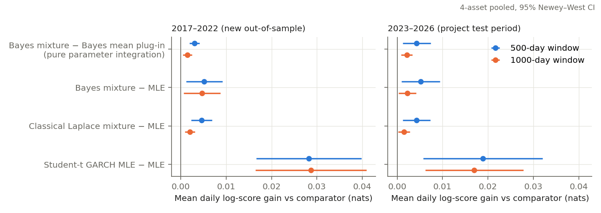
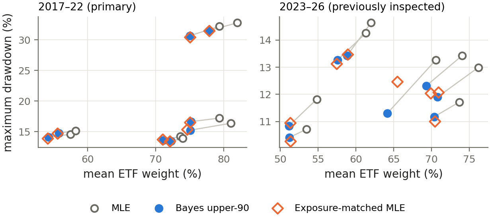

# Bayesian GARCH: From Volatility Forecasting to Portfolio Allocation

**Kang Yu** · quantitative research project · November 2026

> **Research question.** Does accounting for Bayesian parameter uncertainty improve conditional variance forecasts,
> predictive return distributions, and volatility-targeted investment performance?

Daily volatility is predictable, and GARCH(1,1) is the standard model for it. Its parameters are estimated from a few
years of noisy data, yet the usual maximum-likelihood (MLE) forecast treats them as exact. This project tests, strictly
out of sample, whether integrating over a Bayesian posterior helps, and compares that with a different lever:
heavy-tailed innovations (Student-*t* GARCH).

**Start here:** [executive summary (8 pages)](reports/executive_summary.pdf) ·
[full research report (23 pages)](reports/research_report.pdf) ·
[concise notebook](notebooks/quick_walkthrough.ipynb)

## Methods

- **Models.** Gaussian GARCH(1,1) estimated by multi-start MLE in unconstrained coordinates; Bayesian Gaussian
  GARCH sampled by adaptive random-walk Metropolis (4 chains, R̂ < 1.01 and ESS ≥ 400 required for every fit), giving
  posterior-integrated variances, posterior 90th-percentile variances and the posterior predictive Gaussian mixture;
  Student-*t* GARCH estimated by MLE; EWMA and a classical Laplace approximation as comparators.
- **Evaluation.** QLIKE for variance forecasts and the log predictive score for whole densities, compared with
  Diebold–Mariano tests using Newey–West standard errors; out-of-sample residual and PIT diagnostics.
- **Portfolios.** One ETF plus cash, targeting 10% annual volatility without leverage; trades one close after the
  information, 5 bp costs, Fed funds cash; paired circular block-bootstrap intervals for Sharpe and drawdown differences.

## Research design

SPY, QQQ, TLT and GLD, daily adjusted closes from 2013. Every model is refitted every 63 trading days on the latest
500 or 1,000 returns and produces one-step-ahead forecasts each day: 320 refits, each with MLE, a 4-chain MCMC run,
Laplace and Student-*t*. The primary evaluation is 2017–2022 (methods frozen before it was examined); 2023–2026 had
been inspected during development and is reported as a reproduction.

## Principal findings

| | Question | Result (2017–22, primary evaluation) |
|---|---|---|
| **H1** | Better conditional variance forecasts? | QLIKE improves by about 0.005 (p = 0.10 and 0.08): no statistically reliable improvement at 5%. |
| **H2** | Better predictive distributions? | Yes, modestly: +0.005 nats/day for the Bayesian mixture (p ≤ 0.024); a classical Laplace approximation captures 43–89% of it. |
| **H3** | Better volatility-targeted portfolios, beyond holding less risk? | No reliable incremental benefit once exposure is matched. |

**Finding 1 — the innovation distribution matters more than parameter uncertainty.** Student-*t* GARCH estimated by
MLE improves the log score by +0.028 nats/day, about 5–6 times the Bayesian gain in 2017–22 (3.6–7.5 times across all
period–window cells). Parameter uncertainty adds an excess kurtosis of only 0.015–0.046, against 0.4–2.9 in
standardised returns. This holds for the tested Gaussian model; a Bayesian Student-*t* GARCH was not tested.

**Finding 2 — an exposure-matched control removes the apparent portfolio advantage.** The conservative Bayesian
"upper-90" rule holds 3.6 percentage points less ETF than MLE targeting and has a smaller maximum drawdown in all 8
asset–window configurations. Against an exposure-matched MLE control, which keeps the MLE forecast and scales its
volatility target using only past forecasts, volatility, drawdown and Sharpe ratio are nearly identical: no
configuration's bootstrap interval excludes zero, and every Sharpe-difference interval for the four-ETF portfolio
contains zero. The lower drawdown is consistent with holding less risk, not demonstrably better timing.

<p align="center">


</p>

*Left: daily log-score gains over Gaussian MLE with 95% HAC intervals. Right: mean ETF weight against maximum
drawdown; the exposure-matched control (diamonds) lands on top of Bayesian upper-90.*

## Repository contents

| Path | Contents |
|---|---|
| [`reports/`](reports/) | [Executive summary](reports/executive_summary.pdf) and [full research report](reports/research_report.pdf), with editable LaTeX sources, tables, figures and bibliography in [`reports/source/`](reports/source/) |
| [`notebooks/`](notebooks/) | [`quick_walkthrough.ipynb`](notebooks/quick_walkthrough.ipynb) (concise, about 30 s) and [`walkthrough.ipynb`](notebooks/walkthrough.ipynb) (comprehensive, 130 numerical checks); both executed |
| [`src/`](src/) | [`bgarch`](src/bgarch/) (reusable library: models, inference, forecasts, evaluation, portfolio accounting), [`bgarch_experiments`](src/bgarch_experiments/) (study configuration, rolling pipeline, tables, figures, reproduction CLI), and the validated numerical core of the original project (`src/*.py`, imported as `src`, re-exported by `bgarch` without re-implementation) |
| [`tests/`](tests/) | 54 tests: likelihood, transformations, forecast timing, portfolio accounting, reproduction of saved results, diagnostics |
| [`scripts/`](scripts/) | data download, report tables, narrative and presentation figures, number checkers for the reports and slides, course synchronisation |
| [`artifacts/`](artifacts/) | validated outputs: quick-mode and full-run tables, checksums, adequacy tables, figures and diagram sources |
| [`agent_research/`](agent_research/) | records of the AI-agent research phase (plan, log, report, code, aggregate results) — see its [README](agent_research/README.md) |
| [`course/`](course/) | Erdős Institute reviewer package: both reports, both notebooks and the presentation — see its [README](course/README.md) |
| [`docs/`](docs/) | [report-to-notebook coverage map](docs/notebook_coverage.md) and [study guide](docs/study_guide.md) |
| [`data/`](data/) | `DFF.csv` (FRED, public); the ETF price files are not included (see below) |

## Installation

```bash
git clone <repository-url> Bayesian_GARCH && cd Bayesian_GARCH
conda env create -f environment.yml && conda activate bayesian-garch    # or: pip install -r requirements.txt
pip install -e .                                                         # editable install (required: see pyproject.toml)
pytest                                                                   # tests that need only public inputs
```
Python 3.10+ (results were produced with Python 3.12.2 and the versions pinned in `requirements.txt`). Rebuilding the
PDFs needs a LaTeX distribution with BibTeX, natbib, beamer and TikZ.

## Data and saved artifacts

| Input | In this repository? | Needed for |
|---|---|---|
| `data/DFF.csv` — effective federal funds rate, FRED | yes | cash returns |
| `data/{SPY,QQQ,TLT,GLD}_adjusted.csv` — Yahoo Finance adjusted closes, 2013-01-02 to 2026-11-04 | **no** (Yahoo's terms restrict redistribution) | live fits, full reproduction, most tests, notebooks |
| `artifacts/forecasts/` — the saved rolling experiment (daily forecasts, fit logs, 300 posterior draws per day; 95 MB) | **no** (contains returns derived from the price data) | quick reproduction, notebooks, reproduction tests |
| `artifacts/milestone10_market/` — original project outputs used by two cross-checks | **no** (derived market data) | one reproduction test, one notebook cell |
| aggregate tables, checksums, figures, reports | yes | reading and checking the results |

The executed notebooks and the reports can be read without any of the restricted inputs. To run code that needs them:

- **With the original data snapshot** (exact reproduction): place the files under `data/` and `artifacts/` as named
  above, or point `BGARCH_DATA_DIR`, `BGARCH_FORECASTS_DIR` and `BGARCH_M10_DIR` at a private copy. The SHA-256
  manifests in `artifacts/results/` verify that the snapshot is the one used here.
- **With freshly downloaded data**: `pip install yfinance && python scripts/download_data.py`. Yahoo revises adjusted
  closes, so a fresh download will not match the checksums, and results will differ slightly; use full reproduction.

Without the restricted inputs, `pytest` runs the 6 tests that need only public inputs and skips the rest with a stated
reason; with them, all 54 run.

## Reproduction

**Quick reproduction** (saved artifacts; about 20 s; no model fitting):
```bash
python -m bgarch_experiments.reproduce quick     # verify 48 checksums, rebuild every table and figure, compare (282/282 columns)
python -m bgarch_experiments.adequacy             # model-adequacy tables and figures (~8 s)
jupyter nbconvert --to notebook --execute --inplace notebooks/quick_walkthrough.ipynb   # ~30 s, 45 checks
jupyter nbconvert --to notebook --execute --inplace notebooks/walkthrough.ipynb         # ~40 s, 130 checks
python scripts/verify_summary_numbers.py          # every number in the executive summary
python scripts/verify_presentation_numbers.py     # every number on the slides and in the speaker notes
```
The notebooks fit one representative MLE, MCMC and Student-*t* model live (seconds) and recompute every metric from
the saved daily forecasts; they do not rerun the 320 rolling refits.

**Full reproduction** (re-estimates everything from market data; about 70 s on 7 cores of an Apple M3):
```bash
python -m bgarch_experiments.reproduce full --out /tmp/bgarch_full_run   # 320 refits; new or empty directory
```
It reruns the rolling MLE, MCMC, Laplace and Student-*t* fits, rebuilds every table and figure from its own output, and
compares them with the saved results. With the original data on the development machine every table column matched
exactly (`artifacts/results/full_run/full_run.json`); on other platforms Bayesian quantities agree only to Monte Carlo
precision, because MCMC starting points depend on platform linear-algebra libraries.

**Documents.** `python scripts/make_report_tables.py`, then `latexmk -pdf research_report.tex` and
`latexmk -pdf executive_summary.tex` in `reports/source/`; `latexmk -pdf slides.tex` in
`course/presentations/source/`. After changing a report or notebook, run `python scripts/sync_course.py` to update and
verify the course copies.

### AI Assistance and Research Transparency

This project was developed with substantial assistance from AI tools, including Claude Code (Anthropic), Codex (OpenAI), and ChatGPT (OpenAI), under the author's direction. AI assistance contributed to the implementation, independent audit, numerical replication, analysis, documentation, and preparation of research materials.

Quantitative results were validated programmatically against saved experimental artifacts using automated tests, notebook checks, and consistency checkers. The research plan, experiment log, and documentation of the AI-assisted research process are preserved in [`agent_research/`](agent_research/).

## Context and licence

The project was completed for the Erdős Institute *Quantitative Methods in Finance* course (Fall 2026); the reviewer
package is in [`course/`](course/). 

This project is licensed under the MIT License.
