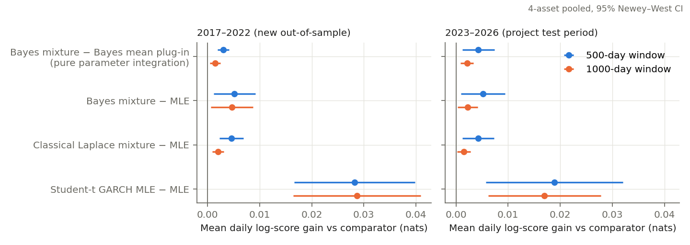
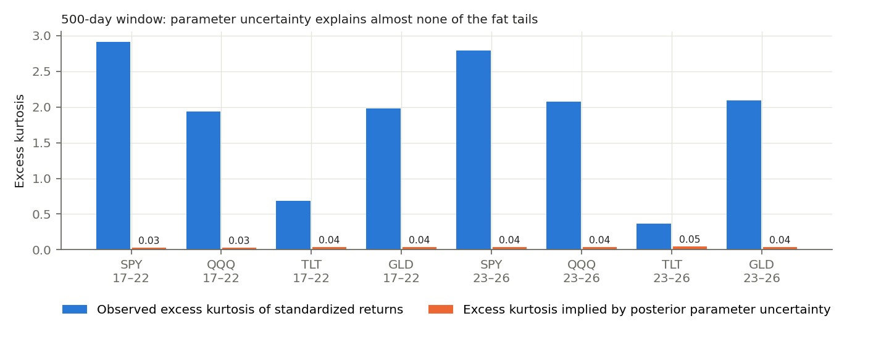
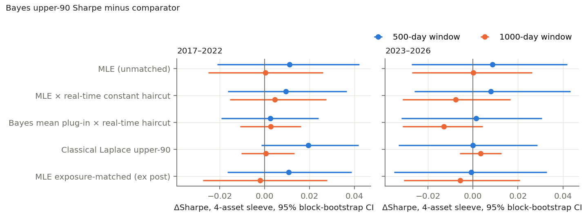
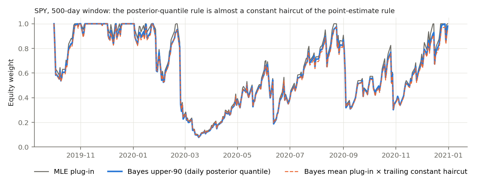

# Does Bayesian parameter uncertainty add value in GARCH(1,1) volatility targeting?

> **Erratum (2026-11-06).** Three summary statements in this report were imprecise; no table, test or result changes.
> (1) The premium regressions have **4 of 32** coefficients significant at 5%, not 3 (QQQ, 500-day window, large-shock
> outcome, p = 0.048, was missed); 1.6 are expected by chance and the signs are mixed, so the conclusion stands.
> (2) The Laplace approximation captures **43–89%** of the Bayesian log-score gain (below half in one cell), not "most"
> or "50–90%". (3) Student-t gains are **about 5–6×** the Bayesian gain in 2017–22 and 3.6–7.5× across all four cells.
> The summary table below is corrected; the body text is left as written. See `course_project/NOTEBOOK_COVERAGE.md`.


Independent assessment of the `erdos_bayesian_garch` project. Report date: 2026-11-05.
Plan: `research_plan.md` · Log: `experiment_log.md` · Code: `code/` · Tables: `results/` · Figures: `figures/`.

## Executive summary

**Answer: no economically meaningful value was found. One small, statistically reliable
exception is in density forecasting, and a classical approximation reproduces it.**

| Question | Finding | Status |
|---|---|---|
| Is the implementation correct? | Yes. Likelihood, MCMC, timing, cash accrual and accounting all pass independent checks. Three methodological issues are listed in §2. | Established |
| Do the saved Milestone 10 results reproduce? | Classical quantities match exactly. Bayesian strategy Sharpe ratios differ by ≤0.005 because of sampler Monte Carlo noise. The "all fits converged" claim does **not** reproduce. | Established |
| Better variance point forecasts (QLIKE)? | Bayesian integrated forecasts beat MLE by 0.001–0.006 QLIKE units (≤0.07% of the loss level). Pooled p = 0.08–0.48; the integration step itself contributes ≈0. | Not supported |
| Better predictive densities (log score)? | Yes: +0.002 to +0.005 nats/day vs MLE (p < 0.03 in both periods). A classical Laplace approximation gets 43–89% of this. A Student-t GARCH gets about 5–6× more in 2017–22 (3.6–7.5× across all cells). | Established, but tiny |
| Better tail-risk (VaR/ES) forecasts? | 1% VaR violations: 2.06% (Bayes mixture) vs 2.15% (MLE) in 2017–22. Student-t gets 1.51%. Model misspecification dominates. | Not supported |
| Does posterior dispersion contain timing information? | No. The "uncertainty premium" predicts forecast errors at chance rates (3/32 tests at 5%). Its correlation with the variance level is 0.99+. | Not supported |
| Better investment outcomes? | `bayes_upper90` vs implementable exposure-matched point-estimate rules: ΔSharpe in [−0.013, +0.009] for the pooled sleeve, every 95% CI includes 0, and 0/8 configurations are significant after Holm correction. The drawdown edge vs unmatched MLE comes entirely from lower exposure. | Not supported (negative result) |
| Exploratory: uncertainty-aware strategies | Three candidates and eight configurations. None passed pre-registered validation, so the holdout was left untouched. | Exploratory, negative |

The new evidence is a **pre-registered out-of-sample replication on 2017-01-03 → 2022-12-30**
(1,510 trading days per series, including the 2018, 2020 and 2022 stress periods). The project had never
used this period for evaluation, and all specifications were frozen at Milestone 10 values. It agrees
with the project's own conclusions from 2023–2026 and makes them considerably stronger.

---

## 1. Scope and design

The models are zero-mean Gaussian GARCH(1,1) for SPY, QQQ, TLT and GLD, with 500- and 1000-day rolling
windows refitted every 63 sessions. The posterior uses the project's "moderate" prior: 4 chains,
2,500 warm-up and 4,000 draws, with 300 draws retained. Allocation is one risky asset plus cash, with a
10% vol target, weights in [0, 1], 5 bp one-way costs, DFF cash lagged one day, and a one-close
execution delay.

**Periods.**
- *Extended OOS (new)*, 2017–2022: the primary evidence, never inspected before.
- *Project test*, 2023-01-03 → 2026-11-04: already studied in Milestones 10–14. It is reproduced here, not used for selection.

**Methods compared.**

| Name | Definition |
|---|---|
| `mle` | MLE plug-in |
| `map` | MAP in transformed coordinates |
| `bayes_meanplug` | Posterior-mean parameter plug-in |
| `bayes_integrated` | Posterior-averaged variance |
| `bayes_upper90` | 90th posterior percentile of the variance |
| `laplace_*` | **New classical uncertainty analogue**: draws from N(û_MLE, observed-information⁻¹) |
| `t_garch` | **New** Student-t GARCH MLE, to measure innovation misspecification |
| `ewma` | EWMA, λ = 0.94 |
| `static_target` | Static weight calibrated on pre-period data |
| `mle_const_rt`, `meanplug_const_rt` | **New implementable exposure controls**: the point-estimate rule multiplied by the trailing-252-day mean (past rows only) of the weight ratio `sqrt(v_point / v_q90)`. Each has the same average conservatism as `upper90` but no day-to-day posterior information. |
| `*_expost` | Hindsight exposure/vol-matched controls (diagnostic only) |

**Inference.**
- Forecast losses: Diebold–Mariano with Newey–West standard errors, per configuration and pooled across the four assets.
- VaR: Kupiec (coverage) and Christoffersen (independence) tests.
- Portfolios: paired circular block bootstrap (20-day blocks, 2,000 reps) for Sharpe and max-drawdown differences, plus HAC for mean daily return differences.
- Multiplicity: Holm correction across the 8 configurations. Windows of the same asset are strongly dependent, so the effective sample is closer to 4 than 8.

## 2. Audit of the existing project

All checks were run with `code/audit_checks.py` (→ `results/audit_checks.json`) and `code/walkforward.py`.

**Verified correct**
- Gaussian GARCH log-likelihood matches an independent plain-Python implementation to 9e-13.
- MCMC posteriors match an independent importance sampler (multivariate-t proposal, ESS ≈ 37–41k) on four refits, including a low-persistence GLD posterior and the March-2020 QQQ fit. Posterior mean persistence agrees to 3e-4; posterior mean and q90 of next-day variance agree within 0.3%.
- No lookahead:
  - Shocking return *t* changes forecasts only from *t+1* on.
  - Changing forecast row *d* changes only the weight held over close(*d*) → close(*d+1*).
  - Static benchmarks use pre-test data only.
  - The EWMA seed uses 2013 data only.
- The DFF cash accrual uses the last rate strictly before the decision date, ACT/360 over calendar days. Checked on a weekend example.
- Saved Milestone 10 equity curves replay exactly through `simulate_portfolio` (max error 3e-16).
- Data: the four ETFs share an identical calendar with no gaps over 4 days. Largest moves (e.g. 2020-03-16) are genuine.
- `pytest`: 47/47 pass.

**Issues found**
1. **Convergence certification is seed/platform-fragile.**
   - Rerunning Milestone 10 with the *same* seed on this machine gives 2 of 128 test-period refits that fail the project's strict R-hat < 1.01 rule (SPY-500 2026-07-13, QQQ-1000 2025-10-08). The saved results report 0 failures.
   - Across all moderate-prior runs, 9 of 768 refits fail, all marginally (R-hat ≤ 1.019).
   - Under the `broad` prior, 19 of 320 fail. Some are genuinely bimodal: TLT-500 2018-07 has R-hat 1.027 and tail ESS 32, with posterior mean persistence 0.39 while the MLE is 0.99, i.e. a "no-GARCH" mode competes with a near-integrated mode.
   - The sampler is adequate for the moderate prior, but "all validated" should not be read as a property of the model. Results were insensitive to excluding failed blocks (`forecast_*_converged_only.csv`).
2. **Bayesian outputs are not bit-reproducible across platforms.** MLE and MAP reproduce to 1e-12. Bayesian variance quantiles differ by 0.5–1.7% from the saved files, probably because `multivariate_normal` start points depend on LAPACK. Different seeds move a configuration's `bayes_upper90` Sharpe by up to **0.010**. That is the same size as most Bayes-vs-classical differences reported in Milestones 10–14, so differences of that size should not be interpreted.
3. **The MLE often sits on an arbitrary box bound.**
   - `mle_fit` bounds logit(p) ≤ 7 (p ≤ 0.99909). In 2017–2026, 25 refits end exactly on this bound, TLT 11, QQQ-500 5, GLD 6, SPY-500 3.
   - Relaxing the bound raises the log-likelihood by at most 1.15 and changes the next-day variance by a median 4.9% (max 9.7%). That is comparable to the Bayesian premium itself.
   - Part of the "Bayes vs MLE" contrast in those refits is therefore *regularization vs an ad-hoc truncation*, not parameter uncertainty. On boundary refits the point-shrinkage QLIKE gain is twice as large (−0.0071 vs −0.0033), but those refits are only 9% of days (`boundary_decomposition.csv`).
4. **Minor.**
   - The "exposure-matched static" benchmark is calibrated on the year before the test. In 2022 that was a high-volatility year, so it under-matches by ~20 pp of exposure for SPY/QQQ (e.g. 0.34 vs 0.53). It should not be called exposure-matched.
   - Milestone 14 tested only 5% VaR, where the Gaussian model happens to be roughly calibrated. The 1% level reveals the misspecification (§4).
   - `ewma_variance` seeds from the first 100 observations of the full sample. This is harmless here (2013 data) but would be lookahead if the sample started inside the test.

**Reproduction** (`results/primary/reproduction_vs_saved_m10.csv`):
- `buy_hold`, `mle`, `map`, `ewma` and `static_target` reproduce to ≤1e-13 in Sharpe, drawdown and exposure.
- Bayesian strategies reproduce within 0.005 Sharpe and 0.0016 exposure, which is Monte Carlo noise.
- The project's qualitative conclusions reproduce.

## 3. Variance and density forecasts

Pooled four-asset Diebold–Mariano results (`results/primary/forecast_pooled_*.csv`). Negative QLIKE and positive log score mean the first method is better.

| Contrast | 2017–22 w500 | 2017–22 w1000 | 2023–26 w500 | 2023–26 w1000 |
|---|---|---|---|---|
| QLIKE: Bayes integrated − MLE | −0.0053 (p .10) | −0.0056 (p .08) | −0.0033 (p .21) | −0.0009 (p .48) |
| QLIKE: integrated − mean plug-in (pure integration) | −0.0010 (p .45) | +0.0008 (p .46) | −0.0016 (p .39) | −0.0006 (p .54) |
| QLIKE: Student-t − MLE | −0.0060 (p .12) | −0.0089 (p .016) | +0.0001 (p .96) | −0.0001 (p .93) |
| Log score: Bayes mixture − MLE | **+0.0052 (p .012)** | **+0.0047 (p .024)** | **+0.0052 (p .015)** | **+0.0023 (p .024)** |
| Log score: mixture − mean plug-in (pure integration) | **+0.0030 (p <.001)** | **+0.0015 (p .004)** | **+0.0043 (p .006)** | **+0.0022 (p <.001)** |
| Log score: Laplace (classical) mixture − MLE | +0.0046 (p <.001) | +0.0020 (p <.001) | +0.0043 (p .006) | +0.0016 (p .018) |
| Log score: Student-t − MLE | **+0.028** | **+0.029** | **+0.019** | **+0.017** |
| Log score: Student-t − Bayes mixture | +0.023 (p <.001) | +0.024 (p <.001) | +0.014 (p .011) | +0.015 (p .002) |



**Established:** integrating over the posterior widens the predictive density in a way that the log
score rewards consistently, in both periods and on every pooled test. The effect is about 0.002–0.005
nats/day, or roughly 1–5 nats over four years.
- A **classical** asymptotic-normal approximation of parameter uncertainty captures most of it. Bayesian *inference* is not essential; acknowledging estimation uncertainty is.
- Replacing the Gaussian innovation with a Student-t (a classical, cheaper change) is worth **4–6× more**, and beats the Bayesian mixture significantly in every pooled test.
- For variance *point* forecasts (QLIKE), Bayesian methods are not reliably better. Whatever small gain exists comes from point-estimate shrinkage, especially in boundary refits, not from integration.

## 4. Tail risk

Mean across 8 configurations (`results/primary/tail_*.csv`):

| | 1% VaR violation rate, 2017–22 | Kupiec rejections (of 8) | 1% VaR violation rate, 2023–26 | Kupiec rejections (of 8) |
|---|---|---|---|---|
| MLE Gaussian | 2.15% | 8 | 1.65% | 4 |
| Bayes mean plug-in | 2.02% | 6 | 1.54% | 4 |
| Bayes posterior mixture | 2.06% | 6 | 1.58% | 4 |
| Laplace mixture | 2.09% | 7 | 1.57% | 4 |
| Student-t GARCH | **1.51%** | **4** | **1.41%** | **1** |
| EWMA | 2.17% | 6 | 1.79% | 6 |

- At 5%, all Gaussian methods are close to nominal: 4.8–5.9% violations, 0–3 rejections.
- Quantile-loss differences vs MLE are of order 1e-5 and rarely significant.

**Why parameter uncertainty cannot fix this** (fig. 4). A Gaussian scale mixture whose variance has
coefficient of variation CV has excess kurtosis 3·CV².
- The posterior CV of next-day variance is 7–12%, implying excess kurtosis of **0.015–0.046**.
- Standardized returns have excess kurtosis of **0.4–2.9** (equities and gold ≈ 2–3).
- Parameter uncertainty therefore accounts for roughly 1–5% of the observed tail thickness. The tail problem is innovation misspecification.



## 5. Is posterior dispersion informative?

Define the "uncertainty premium" `q90/integrated − 1` (`results/primary/info_*.csv`).
- Mean is 0.09–0.15 and standard deviation 0.03–0.07.
- Correlation of q90 with the integrated variance is 0.992–0.9998.
- 20–77% of its variance is within-refit, i.e. driven by the filtered variance path, not by new posterior information.

In HAC regressions of |standardized variance error| and of large-shock indicators on the premium, controlling for log variance level, 3 of 32 coefficients are significant at 5% (about 1.6 expected by chance), and the signs are mixed. **The premium does not predict when the model will be wrong.**
This matches Milestone 13 and now holds on independent data.

## 6. Investment decisions

Equal-weight four-asset sleeve of single-asset vol-target strategies, 5 bp
(`results/primary/alloc_pooled_*.csv`):

| Strategy | 2017–22 Sharpe (w500 / w1000) | max DD | 2023–26 Sharpe (w500 / w1000) | max DD |
|---|---|---|---|---|
| MLE | 0.864 / 0.849 | −14.1% / −14.5% | 0.917 / 0.887 | −6.8% / −6.8% |
| Bayes integrated | 0.870 / 0.851 | −14.2% / −14.6% | 0.924 / 0.895 | −6.6% / −6.8% |
| **Bayes upper-90** | 0.875 / 0.849 | −13.3% / −14.0% | 0.925 / 0.887 | −6.1% / −6.5% |
| Laplace upper-90 (classical) | 0.856 / 0.849 | −13.3% / −14.0% | 0.926 / 0.884 | −5.8% / −6.5% |
| MLE × real-time haircut | 0.866 / 0.844 | −13.3% / −14.0% | 0.918 / 0.895 | −6.5% / −6.5% |
| Bayes mean plug-in × real-time haircut | 0.873 / 0.846 | −13.5% / −14.0% | 0.924 / 0.900 | −6.1% / −6.5% |
| Student-t GARCH | 0.903 / 0.864 | −13.9% / −14.3% | 0.929 / 0.892 | −6.9% / −6.9% |
| EWMA | 0.884 | −13.2% | 0.926 | −7.6% |
| Static (pre-period calibrated) | 0.677 | −18.3% | 1.019 | −5.8% |
| Buy & hold | 0.695 | −25.2% | 1.086 | −10.3% |



**Findings**
- **Sharpe.** Every pooled ΔSharpe for `bayes_upper90` vs MLE, implementable controls, Laplace and ex-post-matched MLE lies in [−0.013, +0.019], and every 95% bootstrap CI includes 0.
- **Per configuration.** Across 8 configs and 2 periods, 0 of 16 `upper90 − mle_const_rt` contrasts are significant after Holm correction. Signs split 6/8 positive in 2017–22 and 2/8 in 2023–26.
- **Drawdown.** `upper90` has a shallower drawdown than MLE in 8/8 configurations in both periods (+0.8 to +1.0 pp). Against the implementable haircut control the mean difference is −0.07 pp (2017–22) and +0.09 pp (2023–26). The drawdown benefit is **fully explained by 3.6–4.1 pp lower average exposure**. Fig. 3 shows why: the upper-90 weight path is almost exactly a constant haircut of the point-estimate path.
- **Costs.** `upper90 − mle_const_rt` ΔSharpe is +0.005 / +0.003 / +0.000 at 0 / 5 / 20 bp in 2017–22, and +0.001 / −0.001 / −0.008 in 2023–26. Higher costs erode it, so there is no hidden edge.
- **Monte Carlo noise.** Re-running the sampler with other seeds moves configuration-level `upper90` Sharpe by up to 0.010. Under the broad prior, all conclusions are unchanged (`seed_prior_sensitivity.csv`).
- **Context.** The choice of variance model (Student-t, EWMA) or of dynamic vs static allocation moves Sharpe by 0.02–0.20, an order of magnitude more than any Bayesian treatment. Even those larger differences are not statistically reliable over these horizons; e.g. dynamic vs static flips sign between periods.



## 7. Limitations and alternative explanations

- **Single model class.** Zero-mean symmetric Gaussian GARCH(1,1). Leverage effects (GJR/EGARCH), realized-volatility inputs and regime switching were not studied. Parameter uncertainty could matter more in richer, weakly identified models. A Bayesian *t*- or GJR-GARCH would be the natural next test but needs new MCMC.
- **Short samples and few assets.** About 6 + 4 years and 4 ETFs, with highly dependent windows. Sharpe differences below ~0.05 cannot be resolved; the bootstrap CI half-width is about 0.03 even for the pooled sleeve.
- **Priors.** Only `moderate` and `broad` were examined on market data. Results did not depend on the choice.
- **Posterior refreshed quarterly.** Within-quarter variation in posterior uncertainty comes only from the filtered path, which limits any "timing" content by construction.
- **Data.** Yahoo-adjusted closes, DFF as the cash proxy, and close-to-close execution. These are shared by all methods, so contrasts are unaffected, but absolute returns are approximate.
- **The 2023–26 period** was studied repeatedly by the project, so its results are a reproduction, not independent confirmation. The independent evidence is 2017–22.

## 8. Conclusions

1. **Established.** The codebase is correct and leak-free, and the project's headline findings reproduce.
2. **Established.** Posterior integration improves Gaussian-GARCH log predictive scores by a small, statistically reliable amount. Classical estimation-uncertainty approximations capture most of this, and switching to Student-t innovations is several times more valuable.
3. **Established (negative).** No reliable improvement in variance point forecasts, 1%/5% VaR calibration, or forecast-error predictability from posterior uncertainty.
4. **Established (negative).** The `bayes_upper90` allocation's lower volatility and drawdown come from lower average exposure. Against implementable, ex-ante exposure-matched point-estimate rules it shows no Sharpe, drawdown or downside-risk advantage in either period.
5. **Practical recommendation.**
   - If a conservative risk budget is wanted, set a lower vol target. It is simpler, cheaper and equivalent.
   - Put modelling effort into innovation distribution and variance dynamics, not posterior integration of a Gaussian GARCH(1,1).
   - Fix the MLE bound issue (widen it, or report boundary fits).
   - Report Monte Carlo variability across seeds whenever Bayesian results are compared at the 0.01-Sharpe scale.

---

## Exploratory Strategy Discovery: Can Posterior Uncertainty Improve Investment Performance?

*All findings in this section are exploratory. No candidate reached the final holdout.*

### 1. Candidates and mathematical motivation

The protocol, configurations, selection rule and stop rule were written into `experiment_log.md`
**before** any candidate was evaluated. Each candidate starts from the posterior-integrated variance
`m_t`, the posterior 90th percentile `q_t` and the saved posterior draws `v_t^(i)`.

- **S1 — Uncertainty-adaptive risk budget.**
  - Rule: `w = min(1, 0.10/√(252 m_t) · exp(−λ z_t))`, where `z_t` is the uncertainty premium standardized by its trailing-252-day mean and sd (past only).
  - Motivation: §6 showed the *level* of the premium is just a constant haircut, so only its *abnormal* time variation could carry information. λ > 0 is more conservative when uncertainty is unusually high; λ < 0 tests the opposite hypothesis.
  - Configurations: λ ∈ {−0.25, 0.25, 0.5}.
- **S2 — Bayesian predictive downside-risk budget.**
  - Rule: size so that the expected shortfall of the full posterior predictive distribution (a Gaussian scale mixture, computed exactly) equals the ES of a 10%-vol Gaussian.
  - Motivation: expected-shortfall-constrained allocation under the Bayesian predictive density. The mixture fattens tails most when parameter uncertainty is largest.
  - Configurations: α ∈ {1%, 2.5%}.
- **S3 — Regime-dependent use of uncertainty.**
  - Rule: use `q_t` only during volatility *transitions*, defined as `m_t > (1+δ) m_{t−5}` (rising); otherwise use `m_t`. A "falling" variant was included.
  - Motivation: the sensitivity of the GARCH forecast to persistence is proportional to `v_t − V`, so parameter uncertainty matters most when variance moves away from its long-run level.
  - Configurations: δ ∈ {0, 0.10}, plus falling with δ = 0.

There were 8 configurations in total, within the budget of 3 × 5.

### 2. Experiments and computational resources

- **Inputs.** Only saved walk-forward forecasts and posterior draws (`results/forecasts/*`). No new MCMC.
- **Periods.**
  - Development: 2017-01 → 2020-12, 8 configurations.
  - Validation: 2021-01 → 2022-12, only the 3 configurations selected on development.
  - Holdout: 2023-01 → 2026-11, **not run**.
- **Runtime.** Development 8.2 s, validation 2.1 s, and a 20 bp cost check for S1 of about 3 s. Total about 15 s of the 30-minute budget.
- **Code.** `code/strategy_discovery.py`. The holdout stage refuses to run unless `results/discovery/validation_decision.json` lists a passing candidate.

### 3. Performance vs benchmarks

Means across 8 asset-window configurations (`results/discovery/*_mean_table.csv`):

| | Dev Sharpe | Dev max DD | Dev turnover | Val Sharpe | Val max DD | Val turnover |
|---|---|---|---|---|---|---|
| Bayes integrated | 0.989 | −12.6% | 3.05% | −0.375 | −17.7% | 4.60% |
| Bayes upper-90 | 0.993 | −12.0% | 3.10% | −0.375 | −16.9% | 4.49% |
| MLE | 0.979 | −12.8% | 2.95% | −0.374 | −17.6% | 4.57% |
| MLE × real-time haircut | 0.983 | −12.1% | 3.02% | −0.380 | −16.9% | 4.43% |
| EWMA | 0.959 | −12.4% | 1.45% | −0.276 | −16.9% | 1.99% |
| S1 (λ = 0.25) | 0.953 | −12.7% | 4.84% | −0.320 | −18.5% | 8.82% |
| S2 (α = 2.5%) | 0.990 | −12.6% | 3.06% | −0.375 | −17.6% | 4.60% |
| S3 (δ = 0.10) | 0.994 | −12.6% | 3.52% | −0.394 | −17.5% | 5.12% |

### 4. Exposure-controlled results

Each candidate was compared with `min(1, k_t · w_integrated)`, where `k_t` is the trailing (past-only) mean
ratio of the candidate's weight to the integrated weight. This matches average exposure in real time and
removes the pure-conservatism effect. Pooled-sleeve ΔSharpe vs this control, with 95% block-bootstrap CIs:

| Candidate | Dev w500 | Dev w1000 | Val w500 | Val w1000 | Val configs beating control |
|---|---|---|---|---|---|
| S1 λ = −0.25 | −0.185 | −0.215 | — | — | — |
| **S1 λ = 0.25** (selected) | −0.054 | −0.058 | +0.095 [−0.09, 0.28] | +0.070 [−0.15, 0.27] | 5/8 |
| S1 λ = 0.5 | −0.132 | −0.185 | — | — | — |
| S2 α = 1% | +0.000 | +0.000 | — | — | — |
| **S2 α = 2.5%** (selected) | +0.000 | +0.000 | +0.001 [−0.001, 0.003] | +0.000 [−0.001, 0.001] | 5/8 |
| S3 δ = 0 | +0.001 | +0.002 | — | — | — |
| **S3 δ = 0.10** (selected) | +0.006 | +0.006 | **−0.032** [−0.065, −0.003] | −0.017 [−0.039, 0.004] | 0/8 |
| S3 falling | −0.013 | −0.014 | — | — | — |

The pre-registered validation criterion required ΔSharpe ≥ +0.05 vs control in both windows, a win in
≥ 6/8 configurations, and turnover ≤ 1.5× the integrated rule. **No candidate passed.**
- **S1** reached the Sharpe threshold but won in only 5/8 configurations, and its turnover was 1.9× the integrated rule.
- **S2** is numerically indistinguishable from its control. The mixture ES is almost proportional to the plug-in ES because posterior variance dispersion is small and nearly constant (§4–5).
- **S3** lost to its control in every validation configuration.

### 5. Robustness and overfitting

- **S1 is unstable in sign.** Every λ lost to its control in development (−0.05 to −0.22); the selected λ = 0.25 then gained +0.07 to +0.10 in validation. That reversal, with CIs spanning ±0.2, is what noise looks like, not a stable effect.
- **S1 depends on costs.** At 20 bp, its validation ΔSharpe vs control becomes −0.12 in both windows. Its apparent gain needs about twice the trading.
- **S3** was best on development by a hair (+0.006) and was worst on validation, consistent with selecting on noise.
- **No holdout reliance.** None of these numbers involve the 2023–26 holdout, and none required re-estimation.

### 6. Recommendation

**None of the three strategies deserves further investigation in this model class.**
- The evidence from the primary study explains why. Posterior dispersion of a Gaussian GARCH(1,1) is small (variance CV 7–12%) and almost a deterministic function of the variance level, so it carries little information beyond the point forecast. Rules built on it either reduce to a constant haircut (S2, upper-90) or add noise and turnover (S1, S3).
- Work that might change this conclusion, and which would need new, more expensive inference (documented as future work, not executed):
  1. A Bayesian Student-t or GJR-GARCH, where tail and leverage parameters are weakly identified and their uncertainty is larger.
  2. Posteriors refreshed daily or weekly instead of quarterly.
  3. Hierarchical, multi-asset models where parameter uncertainty enters covariance estimation.
  4. Longer samples (pre-2013 data) to gain enough power to detect effects under 0.05 Sharpe.

---

## Reproducing this report

From the project root (Python with numpy/scipy/pandas/numba/arviz/matplotlib):

```bash
python agent_research/code/run_grid.py            # 56 walk-forward jobs, ~2.5 min on 7 cores
python agent_research/code/audit_checks.py        # ~75 s
python agent_research/code/analysis_primary.py    # ~25 s
python agent_research/code/make_figures_primary.py
python agent_research/code/strategy_discovery.py dev
python agent_research/code/strategy_discovery.py val
# python agent_research/code/strategy_discovery.py holdout   # refuses: no candidate passed validation
```

Bayesian quantities depend on the platform's random-number and LAPACK behaviour (§2, issue 2). Expect
Monte Carlo-level differences of up to about 1–2% in variance quantiles and about 0.01 in Sharpe on other
machines. Classical quantities reproduce exactly.
